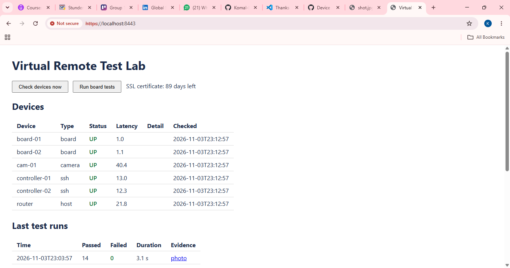
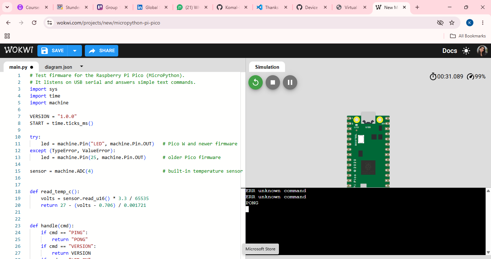
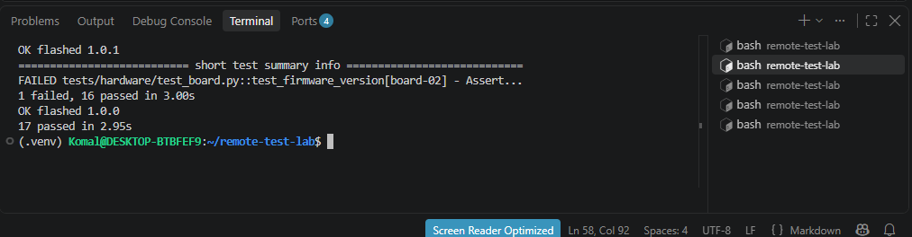
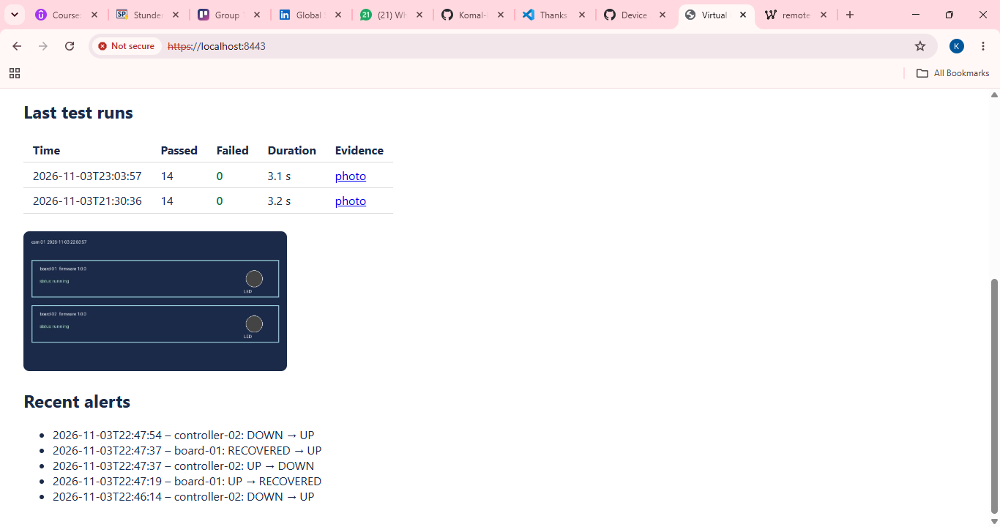

# Remote Test Lab (virtual)

A small remote test lab for embedded boards, modelled on real test infrastructure:
test controllers, target boards and an IP camera, all defined in one inventory file,
with automated tests, a self-healing monitor and an HTTPS dashboard.

## What it does
- **Inventory** (`inventory.yaml`) – single source of truth for every device
- **Hardware tests** – 7 pytest checks per board (14 in total), JUnit reports, camera snapshot as evidence
- **Flash tool** – flashes firmware; the version test catches a wrongly flashed board
- **Health monitor** – checks hosts (ping), controllers (SSH), camera (HTTP) and boards (serial) every 5 minutes, resets a stuck board automatically and logs every status change as an alert
- **Dashboard** – Flask over HTTPS with login; automatic SSL certificate renewal
- **systemd** – boards, camera and dashboard run as services; monitor, nightly tests and certificate check run on timers

## Lab setup
| Real lab | This project |
|---|---|
| Raspberry Pi test controllers | 2 Docker containers with SSH |
| Raspberry Pi Pico boards | 2 simulated boards on virtual serial ports |
| Pico firmware | MicroPython, verified on a virtual Pico in [Wokwi](https://wokwi.com/projects/479708813888143361) |
| IP camera | Fake camera that renders each board's status and LED |

Swapping in a real Pico only needs `port: auto` in `inventory.yaml`.

## Firmware on a virtual Pico
The test firmware (`firmware/main.py`) answers `PING`, `VERSION`, `LED ON/OFF`, `UPTIME` and `TEMP` over serial.
Try it in the browser: [Wokwi simulation](https://wokwi.com/projects/479708813888143361)

## Quick start (WSL Ubuntu)
    python3 -m venv .venv && source .venv/bin/activate
    pip install -r requirements.txt
    docker compose up -d
    bash certs/make_cert.sh
    sudo cp systemd/* /etc/systemd/system/ && sudo systemctl daemon-reload
    sudo systemctl enable --now lab-board@board-01 lab-board@board-02 lab-camera lab-dashboard lab-monitor.timer lab-tests.timer cert-renew.timer

Then open https://localhost:8443.

## Tests
    pytest -q          # 14 hardware tests + 3 unit tests

## Self-healing

## Troubleshooting
See [docs/RUNBOOK.md](docs/RUNBOOK.md).

## Notes
The Flask development server is fine for a lab; in production you would put nginx or gunicorn in front.

## Tech
Python, pytest, pyserial, Flask, SQLite, Docker, systemd, OpenSSL, MicroPython, Linux (WSL)